<div align="center">

# BWO-TI

### Center Bias in Beluga Whale Optimization: An Audit and a Translation-Invariant Repair

**Anonymous authors** · under double-anonymized review

Code, per-run results, and the checks behind every number of the submission

   

</div>

---

## Contents
[Abstract](#abstract) · [Contributions](#contributions) · [Evidence for every reported number](#evidence-for-every-reported-number) · [Method and setup](#method-and-setup) · [Results](#results) · [What the results show and what they do not](#what-the-results-show-and-what-they-do-not) · [Reproducibility notes](#reproducibility-notes) · [Reproducing the study](#reproducing-the-study) · [Repository layout](#repository-layout) · [Data and license](#data-and-license) · [Citation](#citation)

## Abstract
Beluga Whale Optimization (BWO) is a recent swarm algorithm with many variants and applications in engineering design and power-system planning. However, its published update rules contain terms that pull candidates toward the center of the search domain and toward its main diagonal, so its reported accuracy may reflect where the benchmark optimum lies rather than how well it searches. We audit BWO and propose a Translation-Invariant BWO (BWO-TI). BWO-TI rewrites the exploration, exploitation, and whale-fall operators as moves relative to the current agent built from differences of population members and zero-mean steps, and it keeps the balance factor, Lévy flight, and step schedule of the original. The published equations, the authors' code, and a library port were compared with BWO-TI, its single-operator repairs, a recent BWO variant, and established evolutionary and swarm algorithms under equal evaluation budgets, with the optimum at the center, at a random shift, and on the diagonal, on standard benchmark suites, and on constrained mechanical design problems. All original implementations lost many orders of magnitude of accuracy once the optimum left the center, and only the joint repair of the three operators removed this bias. BWO-TI significantly outperformed every original implementation on shifted problems but stayed in the middle of the field, clearly behind success-history differential evolution and restarted covariance matrix adaptation. Reported gains of BWO and its variants should therefore be checked on shifted problems.

## Contributions
1. **Audit of the BWO operators.** The exploration, exploitation, and whale-fall rules of BWO are traced term by term to the parts that pull candidates toward the center of the box and toward its main diagonal. The published equations, the authors' MATLAB code, and the mealpy port are compared, and their differences are documented in `code/bwo.py` and `code/bwo_matlab.py`.
2. **BWO-TI, a translation-invariant repair.** The three move rules are rewritten as moves relative to the current agent, built from differences of population members and zero-mean steps. The balance factor, the Lévy flight, the whale-fall probability, and the step schedule of BWO are kept, and a unit test checks that a shifted problem shifts the whole search trajectory.
3. **Structural-bias test with controls.** Every algorithm is run with the optimum at the center, under a random shift, and under a diagonal shift, with random search as the unbiased control. Only the joint repair of all three operators removes the bias.
4. **Equal-budget comparison.** BWO-TI is compared with the three original BWO implementations, the variant AMBWO, and established evolutionary and swarm algorithms on CEC2017, CEC2022, and nineteen constrained mechanical design problems of CEC2020, all through one evaluation counter.

<p align="center">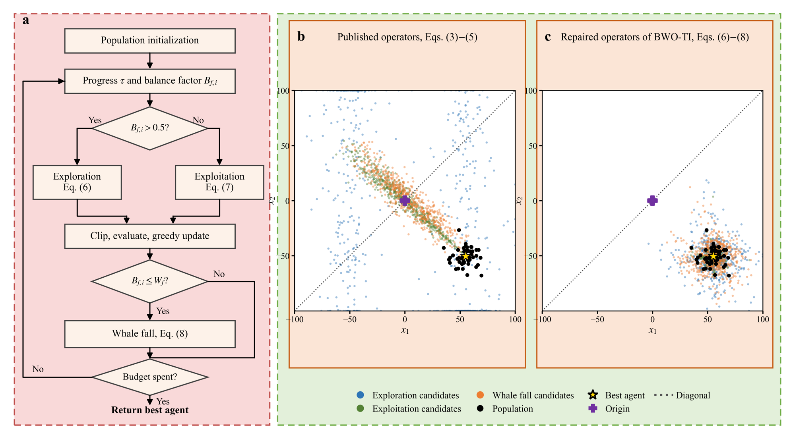</p>
<p align="center"><em><b>Figure 1.</b> BWO-TI. a. Search loop of one iteration. b. Candidates generated in twelve iterations by the published operators for a population of 50 agents clustered around (55,-50) in the box [-100,100]<sup>2</sup>. c. Candidates generated by the repaired operators for the same population. The dotted line is the diagonal, and the cross marks the origin.</em> <a href="figures/Figure_1.pdf">[PDF]</a></p>

## Evidence for every reported number
No number in the paper was typed by hand. Each table can be rebuilt from the per-run results and checked with one command:

| What | Evidence in this repository | How to check |
|---|---|---|
| Table 4, reproduction of AMBWO | `results/bwo-c1/`, `results/bwo-r1/`; published AMBWO values in `reported/ambwo_published_tables.json` | `python verify_results.py` |
| Table 5, Figures 3–4, bias test | `results/bwo-e1/E1_classical_D30.csv` | `python verify_results.py` |
| Tables 6–8, Figures 5–9, CEC suites | `results/bwo-e2/E2_*.csv` | `python verify_results.py` |
| Table 9, Figure 11, design problems | `results/bwo-e3-all/E3_rw2020.csv` | `python verify_results.py` |
| Figure 12, parameter sensitivity | `results/e4/E4.csv` | `python verify_results.py` |
| Figure 13, population diversity | `results/e5/E5.csv` | `python verify_results.py`, Table S28 |
| Supplementary Tables S1–S28 | all of the above | `python verify_results.py` |
| Integrity of the result files | `CHECKSUMS.sha256` | `shasum -a 256 -c CHECKSUMS.sha256` |

`verify_results.py` runs `analysis/e1_bias.py`, `e2_analysis.py`, and `e3_analysis.py`, rebuilds every table of the paper and of its supplementary material from `results/` with `analysis/reproduce_tables.py`, and compares each printed value with the rebuilt one as a printed string. It checks 7,214 printed values in 36 tables: Tables 4 to 9, the values plotted in Figure 12, and Supplementary Tables S1 to S28. All 7,214 match. The per-table counts are in [`reported/verification_report.md`](reported/verification_report.md). Two kinds of numbers are not covered by the script: the published AMBWO means and standard deviations, which are read from the tables of the AMBWO article, and the wall times of Figure 10, which depend on the machine.

## Method and setup
- **Problem.** Minimize f over a box [lb, ub]<sup>D</sup>. An algorithm is center-biased when its error grows once the optimum leaves the center of the box, although the problem itself is unchanged.
- **BWO-TI.** Each candidate is the current agent plus differences of population members or a zero-mean step, so the update never refers to the origin or to the coordinate axes. Without bound handling, a shifted problem gives a shifted trajectory; clipping to the box is the only place where the position of the box enters.
- **Bias test.** The ratio R divides the median error under a random shift by the median error at the center, and D<sub>r</sub> divides it by the median error under a diagonal shift. A function counts as biased when the ratio exceeds 10 and the Holm-corrected rank-sum test is significant; an algorithm counts as biased on at least three of the twelve functions with the optimum at the center. Schwefel's F8 is left out, because its optimum lies near the bound.
- **Comparison.** Friedman ranks on mean errors, Holm-corrected Wilcoxon rank-sum tests for wins, ties, and losses at α = 0.05, and the Nemenyi critical difference.

| Setting | Value |
|---|---|
| Bias test | 13 classical functions, D = 30, 50,000 evaluations, 30 runs per placement |
| CEC suites | CEC2017 in D = 10, 30, 50 with 10,000 D evaluations and 51 runs; CEC2022 in D = 10, 20 with 200,000 and 1,000,000 evaluations and 30 runs |
| Design problems | CEC2020 RC15–RC33, 25 runs, 100,000 evaluations for D ≤ 10 and 200,000 otherwise, static penalty 10<sup>6</sup> times the violation |
| Population | 50 for the BWO group; 30 for GWO, WOA, HHO, MPA, and AMBWO; 100 for PSO; 53 for DE; the published schedules for L-SHADE, jSO, and BIPOP-CMA-ES |
| Errors and ranks | errors below 10<sup>−8</sup> set to zero; mean values within 10<sup>−8</sup> relative ranked as ties |

| Name in the code | Name in the paper | Source of the implementation |
|---|---|---|
| `BWO-P` | BWO | the update equations as printed in the original article, `code/bwo.py` |
| `BWO-ML` | BWO-MATLAB | line-by-line port of the authors' MATLAB code, `code/bwo_matlab.py` |
| `BWO-M` | BWO-mealpy | the BWO class of the mealpy library, `code/bwo.py` |
| `BWO-P+E`, `BWO-P+X`, `BWO-P+W` | BWO+E, BWO+X, BWO+W | BWO with one repaired operator: exploration, exploitation, or whale fall |
| `BWO-TI` | BWO-TI | BWO with all three operators repaired, `code/bwo.py` |
| `AMBWO` | AMBWO | ported from the equations of its article, `code/ambwo.py` |
| `DE`, `L-SHADE`, `jSO`, `BIPOP-CMA-ES` | same | `code/arms.py`, `code/vendor/baselines.py`, pycma |
| `PSO`, `GWO`, `WOA`, `HHO`, `MPA` | same | written from the original articles, `code/vendor/swarm_orig.py` |
| `RS` | random search | uniform sampling of the box |

Every parameter value sits in `code/config.py` together with a tag that states its source.

<p align="center">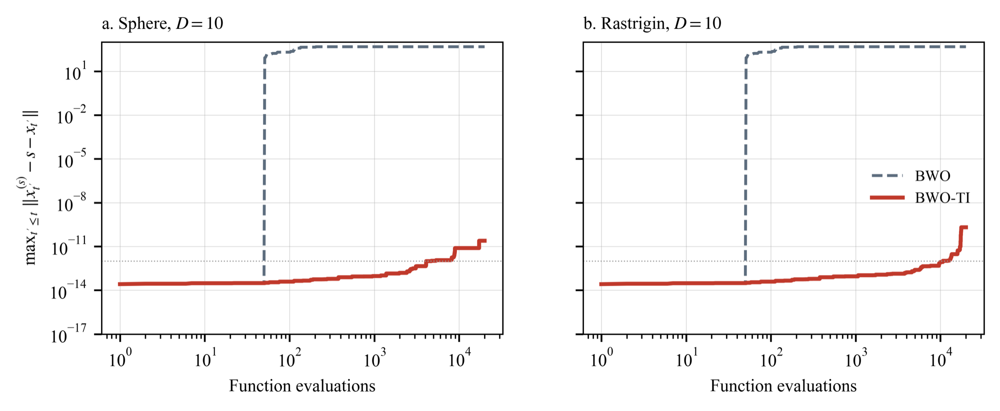</p>
<p align="center"><em><b>Figure 2.</b> Translation check on the sphere and Rastrigin functions in D=10: largest distance between the evaluated points of a run on f(x-s), moved back by s, and those of the run on f(x) with the same seed; median over five seeds. The dotted line marks 10<sup>-12</sup>.</em> <a href="figures/Figure_2.pdf">[PDF]</a></p>

## Results
### Fidelity of the implementations
**Table 4.** AMBWO readings R0–R7 compared with the published AMBWO results, as same/worse/better counts over functions; R0 follows the printed equations.

| Reading | Coefficient | Control factor | Roulette | CEC2017 | CEC2022 |
|---|---|---|---|---|---|
| R0 | printed | printed | proportional | 16/13/0 | 7/4/1 |
| R1 | printed | printed | inverse | 18/11/0 | 7/4/1 |
| R2 | printed | gazelle | proportional | 17/12/0 | 7/4/1 |
| R3 | printed | gazelle | inverse | 19/10/0 | 6/5/1 |
| R4 | decreasing | printed | proportional | 17/12/0 | 6/5/1 |
| R5 | decreasing | printed | inverse | 17/12/0 | 8/3/1 |
| R6 | decreasing | gazelle | proportional | 18/11/0 | 5/6/1 |
| R7 | decreasing | gazelle | inverse | 19/10/0 | 8/3/1 |

### Bias test
**Table 5.** Bias test on the classical functions in D=30. Center and Diagonal give the number of biased functions out of twelve and the median log<sub>10</sub> ratio; W/T/L compares BWO-TI with each algorithm under a random shift over 13 functions.

| Algorithm | Center n | Center log<sub>10</sub> R | Diagonal n | Diagonal log<sub>10</sub> D<sub>r</sub> | W/T/L |
|---|---|---|---|---|---|
| Random search | 0 | 0.01 | 0 | 0.00 | 13/0/0 |
| PSO | 0 | 0.00 | 0 | -0.01 | 1/0/12 |
| DE | 0 | 0.00 | 0 | 0.00 | 2/0/11 |
| L-SHADE | 0 | 0.00 | 0 | 0.00 | 0/0/13 |
| jSO | 0 | 0.00 | 0 | 0.00 | 0/0/13 |
| BIPOP-CMA-ES | 0 | 0.00 | 0 | 0.00 | 0/1/12 |
| GWO | 12 | 8.82 | 1 | 0.22 | 9/0/4 |
| WOA | 10 | 6.30 | 5 | 0.82 | 13/0/0 |
| HHO | 12 | 9.84 | 12 | 4.78 | 12/0/1 |
| MPA | 11 | 7.29 | 4 | 0.52 | 0/0/13 |
| BWO | 12 | 11.13 | 12 | 10.14 | 13/0/0 |
| BWO-MATLAB | 12 | 11.14 | 12 | 10.14 | 13/0/0 |
| BWO-mealpy | 12 | 9.78 | 12 | 4.51 | 13/0/0 |
| AMBWO | 12 | 8.49 | 12 | 3.85 | 7/2/4 |
| BWO+E | 12 | 8.95 | 6 | 1.45 | 12/0/1 |
| BWO+X | 12 | 10.83 | 12 | 10.83 | 13/0/0 |
| BWO+W | 12 | 9.38 | 12 | 9.30 | 11/2/0 |
| BWO-TI | 0 | 0.06 | 0 | 0.01 | – |

<p align="center">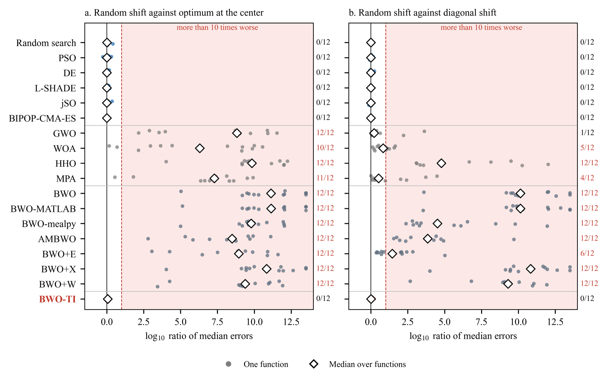</p>
<p align="center"><em><b>Figure 3.</b> Bias ratios on the classical functions in D=30. a. Median error under a random shift divided by the median error with the optimum at the center. b. Median error under a random shift divided by the median error under a diagonal shift. Each dot is one function, the diamond is the median over functions, and the shaded area marks a loss of more than one order of magnitude. The counts give the biased functions out of twelve, in red when the algorithm counted as biased.</em> <a href="figures/Figure_3.pdf">[PDF]</a></p>

<p align="center">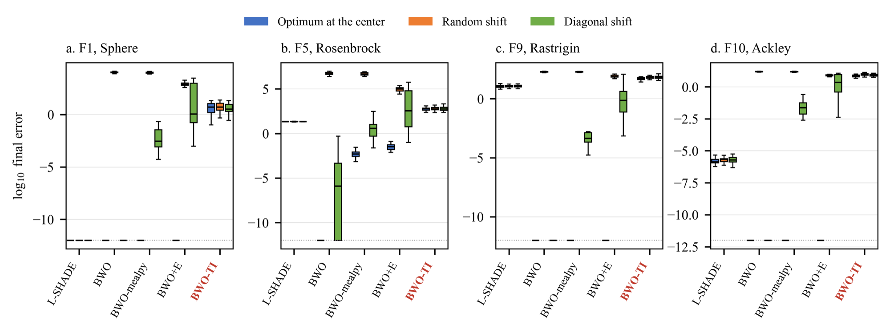</p>
<p align="center"><em><b>Figure 4.</b> Final errors over 30 runs on four classical functions in D=30 under the three placements of the optimum. Errors below 10<sup>-12</sup> are drawn at -12, the dotted line.</em> <a href="figures/Figure_4.pdf">[PDF]</a></p>

### CEC benchmark suites
**Table 6.** Friedman average ranks on the CEC benchmark suites; lower is better. Rows are ordered by the mean over the five suites.

| Algorithm | CEC2017 D = 10 | CEC2017 D = 30 | CEC2017 D = 50 | CEC2022 D = 10 | CEC2022 D = 20 | Mean |
|---|---|---|---|---|---|---|
| jSO | 2.81 | 1.90 | 1.93 | 3.04 | 2.50 | 2.44 |
| L-SHADE | 3.59 | 2.34 | 2.28 | 3.12 | 2.92 | 2.85 |
| BIPOP-CMA-ES | 4.55 | 2.78 | 2.38 | 4.67 | 2.79 | 3.43 |
| MPA | 3.26 | 4.45 | 4.66 | 3.12 | 5.04 | 4.11 |
| DE | 4.52 | 4.78 | 5.38 | 4.04 | 3.96 | 4.53 |
| AMBWO | 5.62 | 6.38 | 6.83 | 5.96 | 6.17 | 6.19 |
| PSO | 7.31 | 6.72 | 6.38 | 7.79 | 7.33 | 7.11 |
| BWO+E | 9.14 | 8.86 | 9.62 | 8.88 | 8.50 | 9.00 |
| GWO | 11.72 | 9.45 | 9.17 | 11.67 | 10.58 | 10.52 |
| BWO+W | 10.52 | 10.69 | 10.72 | 10.83 | 10.42 | 10.64 |
| BWO+X | 12.00 | 12.31 | 12.66 | 11.83 | 12.00 | 12.16 |
| WOA | 13.72 | 12.17 | 11.28 | 13.92 | 12.25 | 12.67 |
| BWO-MATLAB | 8.83 | 16.10 | 15.83 | 9.17 | 15.42 | 13.07 |
| BWO-mealpy | 14.52 | 14.79 | 15.28 | 14.58 | 14.33 | 14.70 |
| HHO | 16.21 | 14.59 | 13.66 | 15.92 | 14.25 | 14.92 |
| BWO | 15.31 | 16.07 | 16.38 | 15.33 | 15.75 | 15.77 |
| BWO-TI | 9.38 | 8.62 | 8.59 | 9.12 | 8.79 | 8.90 |

<p align="center">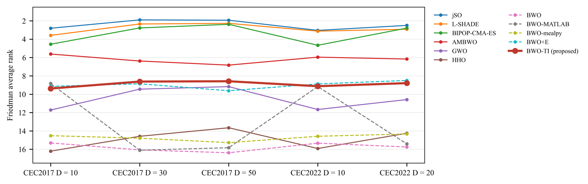</p>
<p align="center"><em><b>Figure 5.</b> Friedman average rank across the CEC suites for BWO-TI, the BWO group, and selected baselines; lower is better. Dashed lines mark the original and partly repaired BWO implementations.</em> <a href="figures/Figure_5.pdf">[PDF]</a></p>

<p align="center">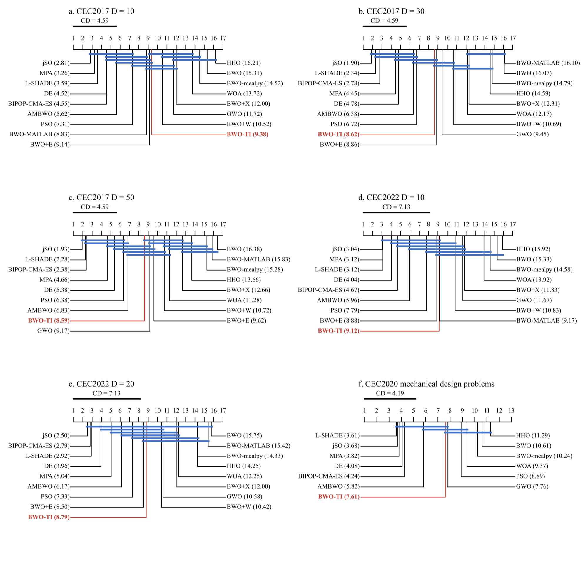</p>
<p align="center"><em><b>Figure 6.</b> Critical-difference diagrams of the Friedman average ranks, Nemenyi test at α=0.05. Lower ranks are better; a bar joins algorithms whose ranks differ by less than the CD. a–e. CEC suites with 17 algorithms. f. CEC2020 mechanical design problems with 13 algorithms.</em> <a href="figures/Figure_6.pdf">[PDF]</a></p>

**Table 7.** W/T/L of BWO-TI against each algorithm on the CEC suites, Holm-corrected rank-sum tests.

| BWO-TI vs | CEC2017 D = 10 | CEC2017 D = 30 | CEC2017 D = 50 | CEC2022 D = 10 | CEC2022 D = 20 | Total |
|---|---|---|---|---|---|---|
| jSO | 0/0/29 | 0/0/29 | 0/0/29 | 0/1/11 | 0/0/12 | 0/1/110 |
| L-SHADE | 0/0/29 | 0/0/29 | 0/0/29 | 0/1/11 | 0/0/12 | 0/1/110 |
| BIPOP-CMA-ES | 0/0/29 | 0/0/29 | 0/0/29 | 0/1/11 | 0/0/12 | 0/1/110 |
| MPA | 0/0/29 | 0/1/28 | 0/0/29 | 0/0/12 | 1/1/10 | 1/2/108 |
| DE | 0/1/28 | 4/1/24 | 4/2/23 | 0/1/11 | 0/0/12 | 8/5/98 |
| AMBWO | 0/2/27 | 2/7/20 | 6/3/20 | 0/4/8 | 1/3/8 | 9/19/83 |
| PSO | 0/9/20 | 1/7/21 | 2/6/21 | 1/5/6 | 1/5/6 | 5/32/74 |
| BWO+E | 12/14/3 | 15/7/7 | 18/4/7 | 6/2/4 | 6/2/4 | 57/29/25 |
| GWO | 11/17/1 | 13/2/14 | 13/0/16 | 8/4/0 | 6/2/4 | 51/25/35 |
| BWO+W | 19/7/3 | 23/3/3 | 23/1/5 | 11/0/1 | 10/1/1 | 86/12/13 |
| BWO+X | 26/2/1 | 28/0/1 | 26/3/0 | 10/2/0 | 10/2/0 | 100/9/2 |
| WOA | 29/0/0 | 29/0/0 | 28/0/1 | 11/1/0 | 8/4/0 | 105/5/1 |
| BWO-MATLAB | 12/11/6 | 29/0/0 | 29/0/0 | 6/5/1 | 11/1/0 | 87/17/7 |
| BWO-mealpy | 27/0/2 | 29/0/0 | 29/0/0 | 12/0/0 | 11/1/0 | 108/1/2 |
| HHO | 29/0/0 | 29/0/0 | 29/0/0 | 11/1/0 | 12/0/0 | 110/1/0 |
| BWO | 27/0/2 | 29/0/0 | 29/0/0 | 12/0/0 | 11/1/0 | 108/1/2 |

<p align="center">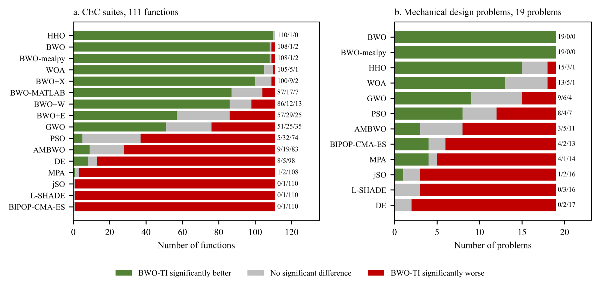</p>
<p align="center"><em><b>Figure 7.</b> Wins, ties, and losses of BWO-TI against each algorithm, Holm-corrected rank-sum tests. a. All 111 CEC functions of the five suites. b. The 19 mechanical design problems. Algorithms are ordered by wins minus losses.</em> <a href="figures/Figure_7.pdf">[PDF]</a></p>

<p align="center">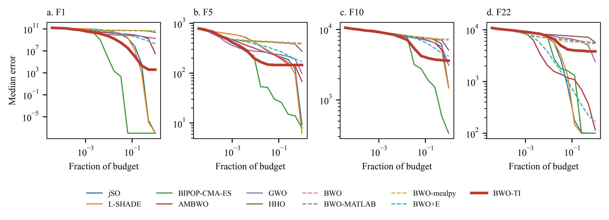</p>
<p align="center"><em><b>Figure 8.</b> Median error over the budget on four CEC2017 functions in D=30: a. unimodal, b. multimodal, c. multimodal with a deceptive structure, d. composition.</em> <a href="figures/Figure_8.pdf">[PDF]</a></p>

<p align="center">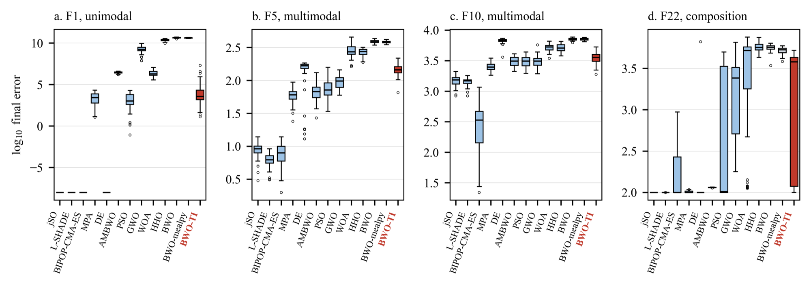</p>
<p align="center"><em><b>Figure 9.</b> Final errors over 51 runs on four CEC2017 functions in D=30. Errors below 10<sup>-8</sup> are drawn at -8.</em> <a href="figures/Figure_9.pdf">[PDF]</a></p>

### Single-operator repairs
**Table 8.** Ablation of the three repairs: bias counts from Table 5, mean Friedman rank over the CEC suites, and W/T/L of BWO-TI over all CEC functions.

| Algorithm | Repair | Center | Diagonal | Rank | W/T/L |
|---|---|---|---|---|---|
| BWO | none | 12 | 12 | 15.77 | 108/1/2 |
| BWO+E | exploration | 12 | 6 | 9.00 | 57/29/25 |
| BWO+X | exploitation | 12 | 12 | 12.16 | 100/9/2 |
| BWO+W | whale fall | 12 | 12 | 10.64 | 86/12/13 |
| BWO-TI | all three | 0 | 0 | 8.90 | – |

### Run time
<p align="center">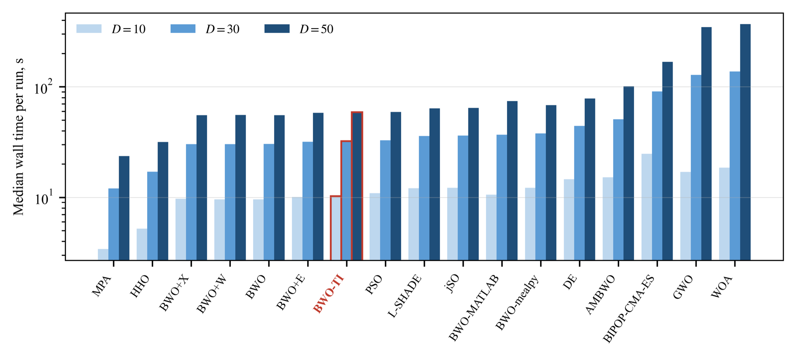</p>
<p align="center"><em><b>Figure 10.</b> Median wall time per run on CEC2017, all algorithms run in the same Python environment under the same evaluation budget; logarithmic scale.</em> <a href="figures/Figure_10.pdf">[PDF]</a></p>

### Mechanical design problems
**Table 9.** Results on the CEC2020 mechanical design problems. Rank is the Friedman average rank on the mean penalized value; Feasible counts feasible final points over 475 runs, and All the problems with every run feasible.

| Algorithm | Rank | Position | p<sub>Holm</sub> | W/T/L | Feasible | All | Feasibility-rule rank |
|---|---|---|---|---|---|---|---|
| L-SHADE | 3.61 | 1 | 0.0186 | 0/3/16 | 447 | 17 | 2.66 |
| jSO | 3.68 | 2 | 0.0211 | 1/2/16 | 449 | 17 | 2.84 |
| MPA | 3.82 | 3 | 0.0271 | 4/1/14 | 441 | 16 | 5.03 |
| DE | 4.08 | 4 | 0.0421 | 0/2/17 | 442 | 16 | 3.29 |
| BIPOP-CMA-ES | 4.24 | 5 | 0.0537 | 4/2/13 | 416 | 15 | 6.45 |
| AMBWO | 5.82 | 6 | 0.627 | 3/5/11 | 436 | 15 | 5.24 |
| GWO | 7.76 | 8 | 0.901 | 9/6/4 | 427 | 15 | 8.00 |
| PSO | 8.89 | 9 | 0.627 | 8/4/7 | 432 | 15 | 8.53 |
| WOA | 9.37 | 10 | 0.627 | 13/5/1 | 411 | 13 | 9.13 |
| BWO-mealpy | 10.24 | 11 | 0.186 | 19/0/0 | 389 | 12 | 11.42 |
| BWO | 10.61 | 12 | 0.105 | 19/0/0 | 379 | 13 | 10.84 |
| HHO | 11.29 | 13 | 0.0319 | 15/3/1 | 377 | 11 | 10.18 |
| BWO-TI | 7.61 | 7 | – | – | 430 | 16 | 7.39 |

<p align="center">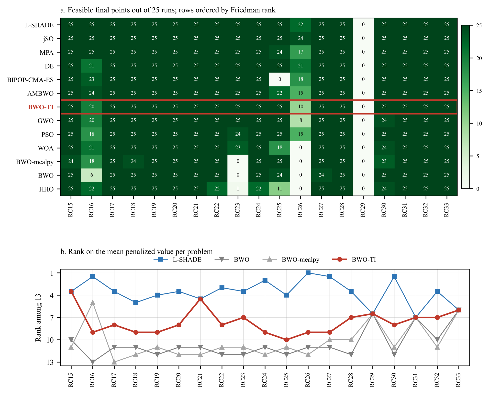</p>
<p align="center"><em><b>Figure 11.</b> CEC2020 mechanical design problems. a. Number of runs out of 25 that ended at a feasible point; rows ordered by the Friedman rank of Table 9. b. Rank of BWO-TI, the original BWO implementations, and L-SHADE on the mean penalized value of each problem.</em> <a href="figures/Figure_11.pdf">[PDF]</a></p>

### Parameter sensitivity
Values plotted in Figure 12: Friedman average rank of the nine settings over the 29 CEC2017 functions in D = 10, lower is better, and W/T/L of the published defaults, n = 50 and Lévy scale 0.05, against each other setting.

| Population n | Lévy scale | Average rank | Defaults vs this setting, W/T/L |
|---|---|---|---|
| 20 | 0.05 | 8.10 | 8/21/0 |
| 30 | 0.05 | 7.03 | 4/25/0 |
| 50 | 0.01 | 6.07 | 1/28/0 |
| 50 | 0.02 | 5.14 | 0/29/0 |
| 50 | 0.05 | 5.28 | defaults |
| 50 | 0.1 | 4.07 | 0/28/1 |
| 50 | 0.2 | 2.28 | 0/25/4 |
| 80 | 0.05 | 4.03 | 0/28/1 |
| 100 | 0.05 | 3.00 | 0/27/2 |

Friedman test over the nine settings: p = 5.7e-20.

<p align="center">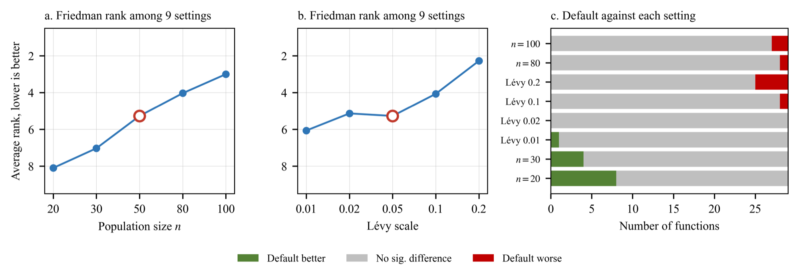</p>
<p align="center"><em><b>Figure 12.</b> Parameter sensitivity of BWO-TI on CEC2017 in D=10, 25 runs per setting. a. Friedman average rank of the population sizes with Lévy scale 0.05. b. Friedman average rank of the Lévy scales with n=50; the open circle marks the published defaults. c. Holm-corrected rank-sum comparisons of the defaults with each other setting over the 29 functions.</em> <a href="figures/Figure_12.pdf">[PDF]</a></p>

### Population diversity
<p align="center">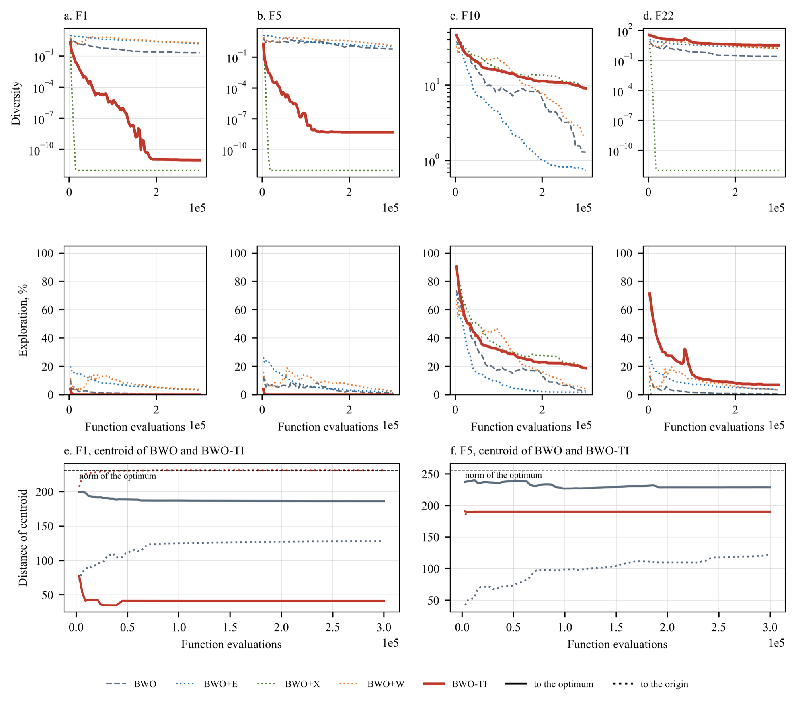</p>
<p align="center"><em><b>Figure 13.</b> Population statistics on four CEC2017 functions in D=30, median over ten runs. a–d. Diversity, the mean absolute deviation from the coordinate-wise median. Second row: exploration share, diversity as a percentage of its maximum in the run. e–f. Distance of the population centroid of BWO and BWO-TI to the optimum, solid, and to the origin, dotted, on F1 and F5, whose optima are the shift vectors; the dashed line marks the norm of the optimum.</em> <a href="figures/Figure_13.pdf">[PDF]</a></p>

Per-function means and standard deviations of every algorithm are in Supplementary Tables S1–S28; `analysis/reproduce_tables.py` rebuilds them into `analysis/out/tables.json`.

## What the results show and what they do not
- **Shown.** The original BWO implementations, the three single repairs, and AMBWO lose many orders of magnitude of accuracy once the optimum leaves the center. BWO-TI does not, and its error ratios stay at the level of random search.
- **Shown.** On the shifted suites BWO-TI beats every original BWO implementation on most functions and returns feasible designs more often.
- **Not shown.** BWO-TI is not a leading optimizer. Success-history DE and BIPOP-CMA-ES stay clearly ahead, and BWO-TI ranks near the middle of the field.
- **Not shown.** The bias test uses one dimension, one budget, and one shift size. BWO-TI is invariant under translation but not under rotation, and clipping to the box can create a bias of its own near the bounds.
- **Not shown.** The published AMBWO results could not be reproduced from its equations, so the AMBWO port follows the printed equations.

## Reproducibility notes
- Every algorithm evaluates through one counter, `code/vendor/budget.py`, which stops a run at exactly the budget; the unit tests check this for every algorithm.
- Seeds are fixed per function and run, so a rerun of one cell gives the same values with the same NumPy version.
- Mean values that differ only by rounding, for example when several algorithms reach the same optimum, are ranked as ties by `analysis/ranking.py`; otherwise the Friedman ranks would depend on the order in which runs are summed.
- AMBWO draws multivariate normal samples, which NumPy 2 draws differently from NumPy 1.26; the AMBWO tests record this.
- The CEC2017 functions and the CEC2020 problems are compiled from the official C++ sources on first use, which needs `g++` or `clang++`.

## Reproducing the study
```bash
python -m venv .venv && source .venv/bin/activate
pip install -r requirements.txt

python verify_results.py                      # rebuild every table from results/ and compare with the paper
cd code && python -m pytest -q tests          # budget, determinism, box, and translation tests

python run.py --exp E1 --out ../results_new/E1 --workers 4                       # bias test
python run.py --exp E2 --suite cec2017 --dim 30 --out ../results_new/E2 --workers 4
python run.py --exp E3 --out ../results_new/E3 --workers 4                       # design problems
python e45.py --exp E4 --out ../results_new/E4 --workers 4                       # parameter sensitivity
python e45.py --exp E5 --out ../results_new/E5 --workers 4                       # diversity
python run.py --exp E1 --smoke --limit 20 --out ../results_new/smoke             # quick check
```
`--shard k --nshards K` splits any experiment over several machines, and each runner skips rows it has already written.

## Repository layout
```
code/            optimizers, benchmark problems, budget counter, experiment runners, unit tests
results/         one row per run for every experiment
analysis/        statistics: e1_bias.py, e2_analysis.py, e3_analysis.py, ranking.py, reproduce_tables.py
reported/        printed table values of the submission, published AMBWO values, verification report
figures/         Figures 1–13 of the paper as PDF, with PNG copies in figures/png
verify_results.py
CHECKSUMS.sha256
```

| Result file | Rows |
|---|---|
| `C1_ambwo_readings.csv` | 9,840 |
| `E1_classical_D30.csv` | 21,060 |
| `E2_cec2017_D10.csv` | 25,143 |
| `E2_cec2017_D30.csv` | 25,143 |
| `E2_cec2017_D50.csv` | 25,143 |
| `E2_cec2022_D10.csv` | 6,120 |
| `E2_cec2022_D20.csv` | 6,120 |
| `E3_rw2020.csv` | 6,175 |
| `E4.csv` | 6,525 |
| `E5.csv` | 200 |
| `R1_ambwo_paper_settings.csv` | 2,460 |

Columns: `arm`, `suite`, `fn`, `dim`, `cond` (U = optimum at the center, Sr = random shift, Sd = diagonal shift, official = benchmark as distributed), `seed`, `run`, `budget`, `fe_used`, `best`, `error`, `sec`. For E3, `ops` holds the objective and the constraint violation of the final point; E5 rows hold 100 snapshots of diversity and centroid distances in `rec`.

## Data and license
- Code of the authors: MIT, see `LICENSE`.
- `code/vendor/cec2017_official` and `code/vendor/cec2022_data`: official CEC benchmark code and data.
- `code/vendor/cec2020rwc_src`: C++ implementation of the CEC2020 real-world problems, GPL, see its `LICENSE`.
- `code/vendor/third_party/evolopy`: reference GWO and WOA code, see its `LICENSE.txt`.

## Citation
The citation will be added after the review.
